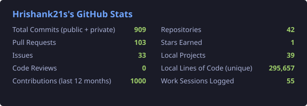

**I build practical software, automation, AI tools and hardware — taking ideas from *"can we build this?"* to something actually running.**

Hi, I'm **Hrishank Soni**, a full-stack and embedded developer. I build web apps and SaaS on **TypeScript, React, Node.js and Cloudflare Workers (D1/SQLite)**, self-hosted **AI agents and automation**, **Android apps**, and **ESP32 / IoT hardware** projects. Open to freelance work and collaboration.

**🟢 Available for freelance work:** Cloudflare Workers / D1 backends · payment & webhook integrations · React dashboards · Android apps · ESP32 prototypes

---

## 🚀 What I'm Building

| | |
| --- | --- |
| 🧩 **TableTracker** | Club-management software (bookings, billing, live tables) built around real-world workflows, running on Cloudflare Workers + D1. |
| ☕ **Weekend Rush Café** | QR ordering, Cashfree payments, chef dashboard and sales reports. |
| 🏆 **Club Tournament** | End-to-end pool tournament platform: registration, brackets, live matches, results. |
| 🤖 **AI & Dev Tooling** | Local AI, coding agents and automation — see [AgentOS](https://github.com/Hrishank21s/DIY-agent-OS). |
| ⌨️ **Type Recall** | A browser typing game published on Y8 that trains memory as well as speed — [play it](https://www.y8.com/games/type_recall). |
| 🛠️ **DIY / Hardware** | ESP and electronics projects alongside software. |

Most of this is under active, private development. Public work is below.

## ⭐ Public projects you can explore

| Project | What it is |
| --- | --- |
| [**Lead Generation Manager**](https://github.com/Hrishank21s/lead-generation-manager) | Local, open-source AI-assisted lead research and client-onboarding CRM. [See dashboard screenshot](https://github.com/Hrishank21s/lead-generation-manager/blob/main/docs/dashboard.png). **Prototype**. |
| [**AgentOS**](https://github.com/Hrishank21s/DIY-agent-OS) | Self-hosted personal AI agent platform for macOS — Fastify + React + SQLite, with the OpenCode CLI as a swappable AI brain. |
| [**Portfolio site**](https://hrishank21s.github.io) | Overview of my work across AI, software, automation and hardware — [source](https://github.com/Hrishank21s/hrishank21s.github.io). |
| [**Kali Dinali**](https://github.com/Hrishank21s/kali-dinali-releases) | Android shop-management app — release builds and install guide. |
| [**Type Recall**](https://github.com/Hrishank21s/type-recall) | Read-ahead typing game: upcoming words vanish and you type them from memory. [▶ Play on Y8](https://www.y8.com/games/type_recall) · [gameplay video](https://github.com/Hrishank21s/type-recall/blob/main/media/typerecall.mp4). |

## 🤝 Work with me

I help small businesses and founders ship working software, from idea to production, and fix systems that are stuck.

| I can help you with | Proof |
| --- | --- |
| **Cloudflare Workers / D1 / R2 backends:** build, debug, migrate, deploy safely with rollback | TableTracker, Café and Club Tournament all run live on Workers + D1 |
| **Payments & webhooks:** checkout, signature verification, idempotent order handling, refunds | Cashfree integrations in the Café and Club Tournament |
| **Booking, billing & internal dashboards** | TableTracker: live table timers, billing, customer ledger, online booking |
| **Android apps** (Kotlin/Java), including offline-first | Kali Dinali shop app, the Café's chef app |
| **AI agents & automation** | [AgentOS](https://github.com/Hrishank21s/DIY-agent-OS), [Lead Generation Manager](https://github.com/Hrishank21s/lead-generation-manager) |
| **ESP32 / IoT prototypes** | Bluetooth presence scanner, 433 MHz monitors |

Every product ships with automated tests (1,350+ across my projects). You get clear updates and code the next developer can maintain.

**Have a project?** [Hire me on Upwork](https://www.upwork.com/freelancers/~01e7d1cfb0c7b0dade) · [email your requirements](mailto:hrishank21s@gmail.com?subject=Project%20enquiry) · [see live walkthroughs](https://hrishank21s.github.io/)

## 🧰 Tech I Use

## 📊 GitHub Stats

## 💡 Approach

> Build it. Test it. Break it. Fix it. Ship it.

I learn by building — turning rough ideas into working systems and improving them continuously.

